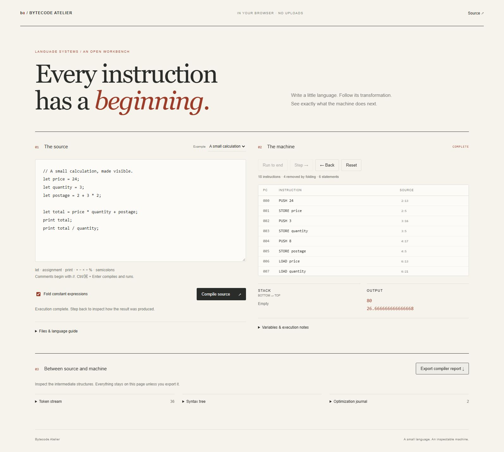

# Bytecode Atelier

A browser-local compiler workbench for a small arithmetic language. Write source, inspect its tokens and syntax tree, compare constant-folded bytecode, and step a reversible stack machine forward or backward.



## Interface

The debugger keeps source, bytecode, and machine state in adjacent panes. A shared toolbar compiles, runs, steps, reverses, and resets execution. The source editor has synchronized line numbers, and the active instruction scrolls into view. Variables and output remain visible while stepping; compiler artifacts and file/language controls open separately. Narrow screens place machine state below the two code panes.

## Start

```sh
python run.py
```

Open http://127.0.0.1:8000/. Python 3.11+ is sufficient to serve the app; there are no Python or npm runtime dependencies. Use `--port 8820` for a different local port. A current browser with JavaScript modules is required. Source is processed in the browser, not sent to the server or saved automatically.

## Try it

1. Compile the sample. Its constant postage expression becomes one `PUSH` instruction.
2. Step once to push the price, then step again to store it. Inspect the stack and variables.
3. Run to the end. The sample prints `80` and `26.666666666666668`.
4. Use Back to reverse instructions, including printed output and variable assignments.
5. Choose **Division by zero**. Execution prints `12`, then stops at division by zero and selects the `/` token in the editor. The previous output remains.

Ctrl/⌘ + Enter compiles and runs. Source-location buttons select their original token. Source files and complete JSON reports can be downloaded; opening a UTF-8 `.atelier` or text file preserves its contents without running it. A delayed import cannot overwrite edits or a newer selection.

## Language

```text
// Define, calculate, mutate, print.
let width = 12;
let height = 3 + 4;
let area = width * height;
print area;
area = area / 2;
print area;
```

```ebnf
program    = statement* ;
statement  = "let" name "=" expression ";"
           | name "=" expression ";"
           | "print" expression ";" ;
expression = additive ;
additive   = product (("+" | "-") product)* ;
product    = unary (("*" | "/" | "%") unary)* ;
unary      = ("+" | "-") unary | primary ;
primary    = number | name | "(" expression ")" ;
```

Names match `[A-Za-z_][A-Za-z_0-9]*`, are case-sensitive, and must be declared before use. `let` and `print` are reserved. Duplicate declarations fail; assignment updates an existing variable. Number literals are digits with an optional decimal fraction (`12`, `12.5`); exponent notation and leading-dot decimals are not supported. Unary minus supplies negative values. Comments begin with `//` and end at the next newline.

Arithmetic uses JavaScript's finite double-precision numbers, bounded to ±1e12. Division returns a decimal and `%` is remainder, including negative operands. There are no strings, comparisons, loops, functions, imports, or host-language evaluation. This is a deliberately small educational language, not a production compiler or a sandbox for arbitrary JavaScript.

## Pipeline and decisions

- **Tokenizer:** source offsets and one-based line/column spans, including comments and CRLF input.
- **Parser:** precedence climbing, left-associative binary operations, tighter unary signs, explicit statement terminators.
- **Semantic pass:** declaration-before-use, duplicate detection, and valid assignment targets.
- **Optimizer:** bottom-up literal constant folding. It does not propagate mutable variables, reassociate expressions, or erase runtime faults. An invalid constant division is retained so earlier observable output occurs before its fault.
- **Emitter:** `PUSH`, `LOAD`, `STORE`, `NEG`, `ADD`, `SUB`, `MUL`, `DIV`, `MOD`, and `PRINT`, each mapped to a source location.
- **VM:** explicit stack, program counter, variable map, output buffer, and bounded snapshot history. Faulting arithmetic leaves its operands intact. Back restores up to 256 previous states; Reset starts the same compiled code again.

Source is limited to 32,000 characters, 4,000 tokens, 256 statements, and 128 levels of expression nesting/tree depth. Imported files have a 128 KB byte limit and must also meet the source-character limit. Bytecode views page at 80 rows; token previews stop at 200 while exports preserve all tokens. Compilation failure or an input edit clears stale executable results.

`core.js` is independent of the DOM and can also be imported in Node:

```js
import {compile, Machine} from './core.js';
const report = compile('print 2 + 3 * 4;');
const machine = new Machine(report.code);
console.log(machine.run().output); // [14]
```

## Verification

```sh
node --test
npm run check
python -m unittest discover -s tests -v
```

Tests cover arithmetic semantics, lexical spans, semantic failures, runtime faults, reverse execution, resource bounds, malformed bytecode, and 250 deterministic optimized/unoptimized equivalence cases. The local server test verifies asset routing, HEAD, loopback Host validation, and refusal to expose repository internals. CI runs Node 22 and 24 on Linux and Node 24 on Windows.

Browser verification exercised compile/run/step/back, stale-result invalidation, diagnostic selection, and the exported JSON report. No browser automation dependency is required to run the app or its unit tests.

The optional Python launcher serves only the four frontend assets and binds to loopback. Its content-security policy disables network connections from the page. It is a local development server, not an internet deployment server.
